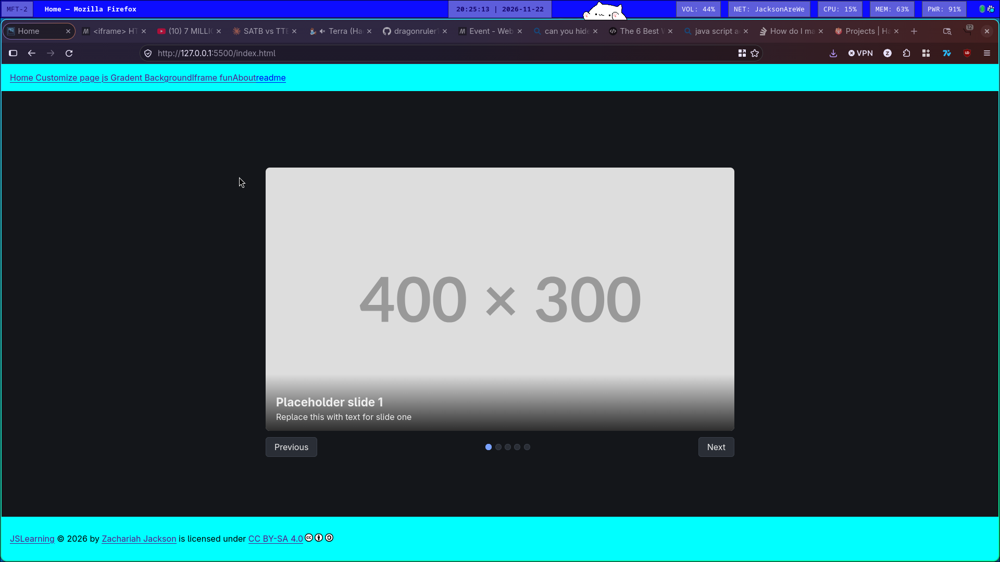
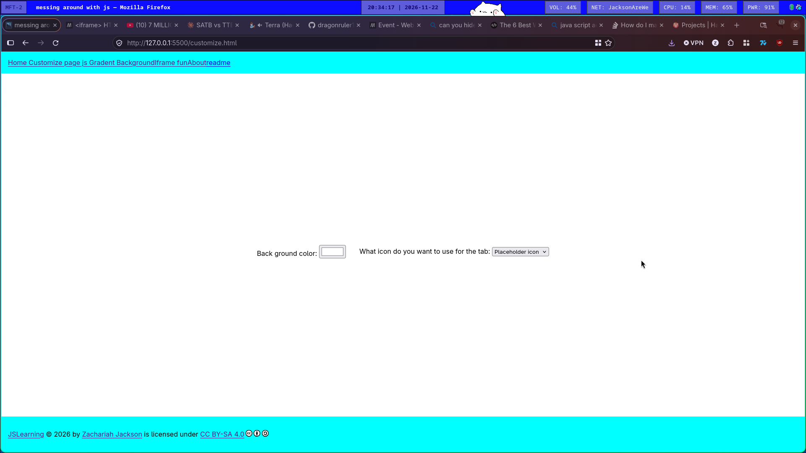
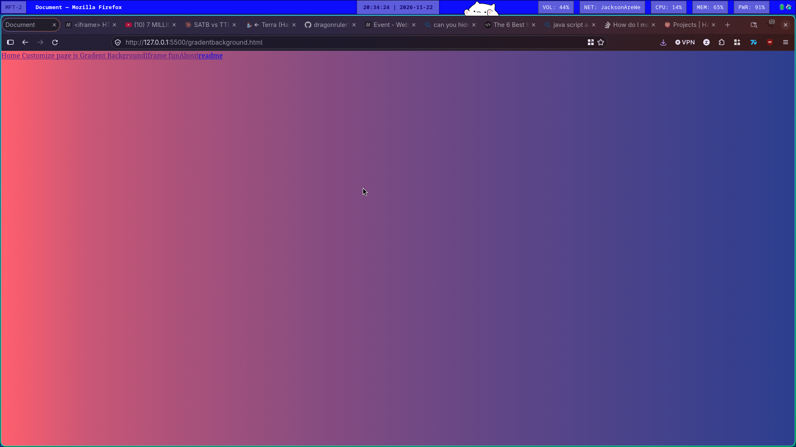
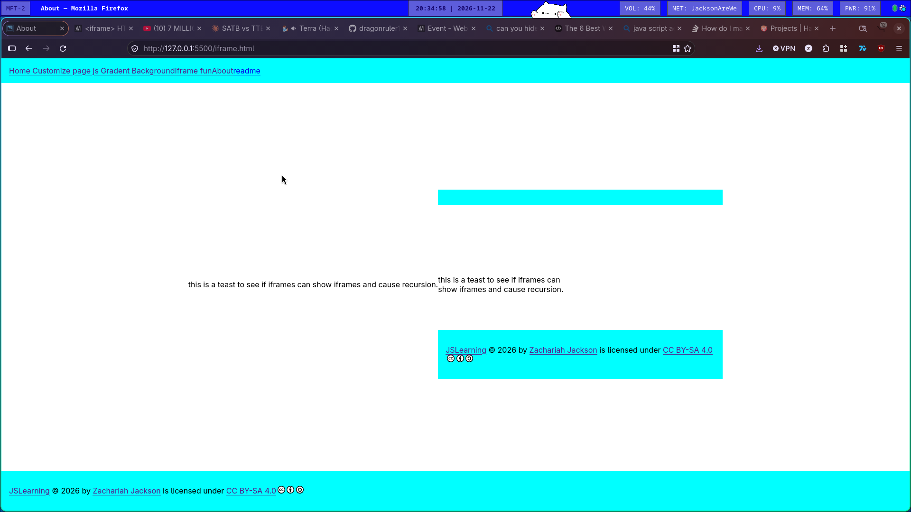
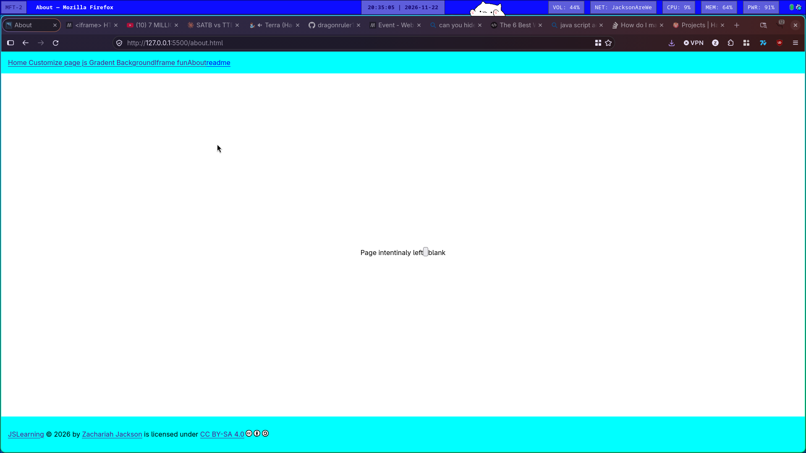

# EComerse-dev
a website i am using to learn how to use javascript.
i decided too pivot from making an ecomersce site to learning how to use java script because i decided that exsisting tools for ecommerse sites work better then making one out of just html, css, and js sense php is better suited for it but that makes a site no longer static and so that way i would need to self host it rather then just use cloudflare pages to run it.
the hard part about making this was finding the motovation to work on it and figureing out what i wanted to add. the mozzila developer docs where quite helpful for this project.
## screenshots

